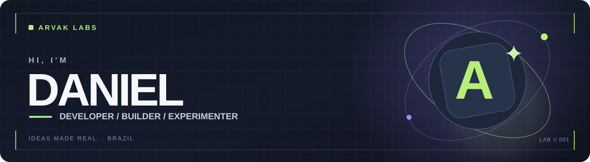

  

   

  

  

    
    
  

---

### `> whoami`

Hey! I'm **Daniel**, a developer based in Brazil. I enjoy building useful software, untangling technical problems, automating repetitive work, and experimenting with ideas that don't quite fit into a single category.

My work spans **web development, scripting, quality assurance, test automation, integrations, and troubleshooting**. Outside conventional software projects, I also create game mods and little experiments just to see what's possible.

> **My favorite kind of project:** a small idea that turns into something people can actually use.

- 🧩 **Build:** practical apps, tools, and web experiences
- 🔧 **Solve:** bugs, tricky integrations, and everyday workflow problems
- 🧪 **Explore:** alternative timelines, reasoning tools, audio loops, and game systems
- 🌱 **Learn:** by shipping, testing, improving, and sharing

### `> toolbox --list`

  

 

| Focus | Tools &amp; experience |
|:--|:--|
| **Web &amp; application development** | JavaScript, TypeScript, Vue 3, Node.js, HTML, CSS |
| **Automation &amp; quality** | Python, Playwright, Jest, Selenium, QA, workflow automation |
| **Data &amp; integrations** | PostgreSQL, MongoDB, DynamoDB, SQL Server, Supabase, APIs |
| **Infrastructure &amp; investigation** | AWS, Docker, Linux, logs, incident analysis |
| **Creative development** | Independent apps, prototypes, game mods, experiments |

### `> projects --featured`

<table>
  <tr>
    <td width="50%" valign="top">
      <h3>🌌 NEXO</h3>
      Explore personal timelines, branching choices, and alternate versions of what could have happened.
        
      <a href="https://github.com/danielrosajr/nexo-personal-multiverse">Source code ↗</a> · <a href="https://danielrosajr.github.io/nexo-personal-multiverse/">Web app ↗</a>
    </td>
    <td width="50%" valign="top">
      <h3>💧 HidroCondo</h3>
      Keep track of condominium water meter readings and make consumption easier to understand.
        
      <a href="https://github.com/danielrosajr/HidroCondo">Source code ↗</a> · <a href="https://danielrosajr.github.io/HidroCondo/">Web app ↗</a>
    </td>
  </tr>
  <tr>
    <td width="50%" valign="top">
      <h3>🏛️ Cívica</h3>
      Make civic and political education more approachable through clear, accessible learning experiences.
        
      <a href="https://github.com/danielrosajr/civica">Source code ↗</a> · <a href="https://danielrosajr.github.io/civica/">Web app ↗</a>
    </td>
    <td width="50%" valign="top">
      <h3>🧠 Contraponto</h3>
      Structure thoughts, questions, counterarguments, and different points of view in a visual reasoning space.
        
      <a href="https://github.com/danielrosajr/contraponto">Source code ↗</a> · <a href="https://danielrosajr.github.io/contraponto/">Web app ↗</a>
    </td>
  </tr>
  <tr>
    <td width="50%" valign="top">
      <h3>🎙️ VozLoop</h3>
      Record vocal layers and loops directly in the browser — a lightweight way to experiment with a cappella ideas.
        
      <a href="https://github.com/danielrosajr/VozLoop">Source code ↗</a> · <a href="https://danielrosajr.github.io/VozLoop/">Web app ↗</a>
    </td>
    <td width="50%" valign="top">
      <h3>🎮 WorldBox Horror Mods</h3>
      Experiments with horror-driven gameplay and unusual NPC behavior: <i>The Unrelenting</i> and <i>SCP-096: The Shy Guy</i>.
        
      <a href="https://github.com/danielrosajr/worldbox-the-unrelenting">The Unrelenting ↗</a> · <a href="https://github.com/danielrosajr/worldbox-the-shy-guy">SCP-096 ↗</a>
    </td>
  </tr>
</table>

  <a href="https://danielrosajr.github.io/"><strong>✦ See more apps, mods, tools, and experiments at Arvak Labs →</strong></a>

 

### `> github --stats`

  
  

These cards are provided by third-party services and may occasionally be unavailable. The language chart reflects repository code, not a ranking of professional proficiency.

### `> contributions --animate`

  <picture>
    <source media="(prefers-color-scheme: dark)" srcset="https://raw.githubusercontent.com/danielrosajr/danielrosajr/output/github-contribution-grid-snake-dark.svg" />
    <source media="(prefers-color-scheme: light)" srcset="https://raw.githubusercontent.com/danielrosajr/danielrosajr/output/github-contribution-grid-snake.svg" />
    
  </picture>

The animation appears after the included GitHub Actions workflow runs successfully for the first time.

---

  <strong>Good software starts with curiosity.</strong>
   
  Built with patience, experiments, and probably more debugging than expected.
    
  <a href="https://danielrosajr.github.io/">Arvak Labs</a> · <a href="https://github.com/danielrosajr?tab=repositories">Repositories</a> · <a href="https://github.com/danielrosajr">GitHub Profile</a>

